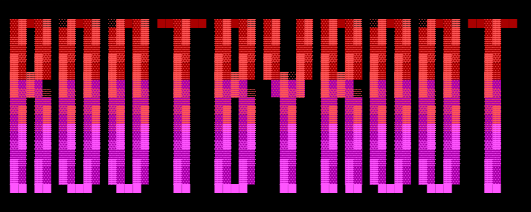

<p align="center">
  <!-- BANNER PLACEHOLDER: Replace src with your RootByRoot banner image path or URL -->
  
</p>

<h1 align="center">RootByRoot</h1>

<p align="center">
  <strong>Clean, #000000 terminal-style console packaged as a Windows .exe for network diagnostics, service checks, and stage-based workflows.</strong>
</p>

<p align="center">
  <a href="#download--run-exe">Download .exe</a> •
  <a href="#visual-overview">Visual Overview</a> •
  <a href="#workflow-stages">Workflow Stages</a> •
  <a href="#credits--attribution">Credits</a> •
  <a href="#license">License</a>
</p>

---

## Visual Overview

Designed like a crisp, dark Linux/CMD terminal window (`#000000` background, monospace typography, and banner-matched accents) delivered as a ready-to-run **.exe** executable.

```text
+-------------------------------------------------------------------+
| root@rootbyroot: ~                                       [-] [+] [x] |
+-------------------------------------------------------------------+
| File   Edit   View   Search   Terminal   Help                     |
+-------------------------------------------------------------------+
| [STAGE 0-2] Initializing diagnostic checks...                     |
| [OK] Target reachable • Service inventory ready                   |
| [PAUSE] Operator confirmation required before next stage [Y / N]   |
+-------------------------------------------------------------------+
| root@roootbyroot~ [>] Target or file: _                           |
+-------------------------------------------------------------------+
```

### What You Get Out of the Box

- **Single `.exe` Launch:** Download `RootByRoot.exe`, double-click, and open the terminal console with zero manual setup.
- **Pure `#000000` Terminal UI:** High-contrast monospace log stream, quick top menus, and instant keyboard shortcuts.
- **Stage-by-Stage Control:** Run step-by-step checks, pause for operator confirmation (`Y / N`), resume, stop, or clear logs cleanly.
- **WSL Bridge Ready:** Works cleanly in the interface and can connect with WSL/Linux diagnostic tools when configured on your Windows machine.

---

## Download & Run (`.exe`)

1. Go to the **Releases** page on GitHub and download the latest `RootByRoot.exe` build.
2. Launch `RootByRoot.exe` on Windows.
3. Enter your target or file at the prompt and start your session:

```text
root@roootbyroot~ [>] Target or file: 192.168.1.10
```

> **Note:** If you enable WSL-backed tools in your setup, make sure WSL and your configured Linux utilities are available on the host system. Use RootByRoot strictly on systems and networks you own or are authorized to inspect.

---

## Workflow Stages

| Stage | Focus | Operator Flow |
| :--- | :--- | :--- |
| **Stages 0–2** | Initial target checks & baseline info | Streams live terminal output |
| **Checkpoint** | Confirmation gate (`Y / N`) | Pauses until you approve or stop |
| **Stages 3–6** | Deeper checks & session summary | Continues or wraps up cleanly |

---

## Quick Controls & Shortcuts

| Action | Shortcut / Control |
| :--- | :--- |
| Run command / target | `Enter` |
| Command history | `ArrowUp` / `ArrowDown` |
| Clear terminal | `Ctrl + L` or `Terminal -> Clear Terminal` |
| Search / filter output | `Ctrl + Shift + F` or `Search -> Find` |
| Fullscreen mode | `F11` or `View -> Full Screen` |
| Credits & info | `Help -> About RootByRoot` |

---

## Credits & Attribution

Created and designed by **[Notoluwyn Studio](https://github.com/notoluwyn-dev)**.

- **Repository:** `https://github.com/notoluwyn-dev/RootByRoot/`
- **Author / Handle:** `Notoluwyn Studio`
- **Extra Notes / Links:** `Good Job`

Please keep attribution intact and include the `LICENSE` and `NOTICE` files if you share or redistribute builds.

---

## License

This project is licensed under the **Apache License 2.0**. See the [LICENSE](LICENSE) and [NOTICE](NOTICE) files for details.
